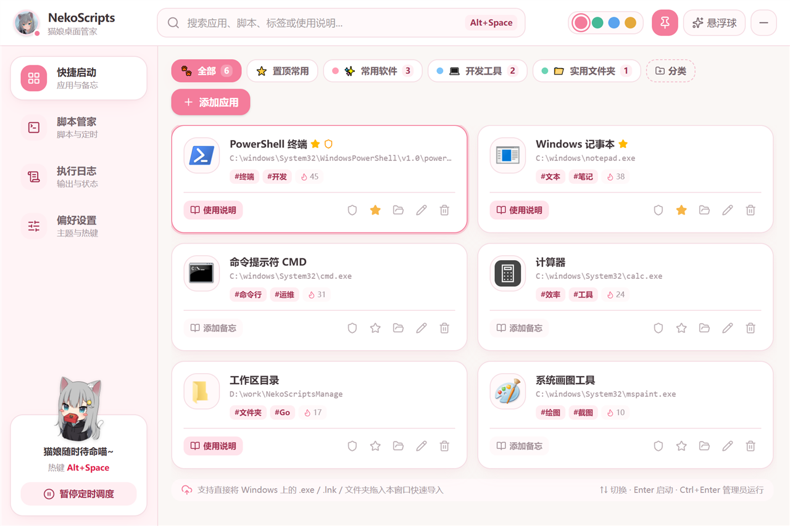
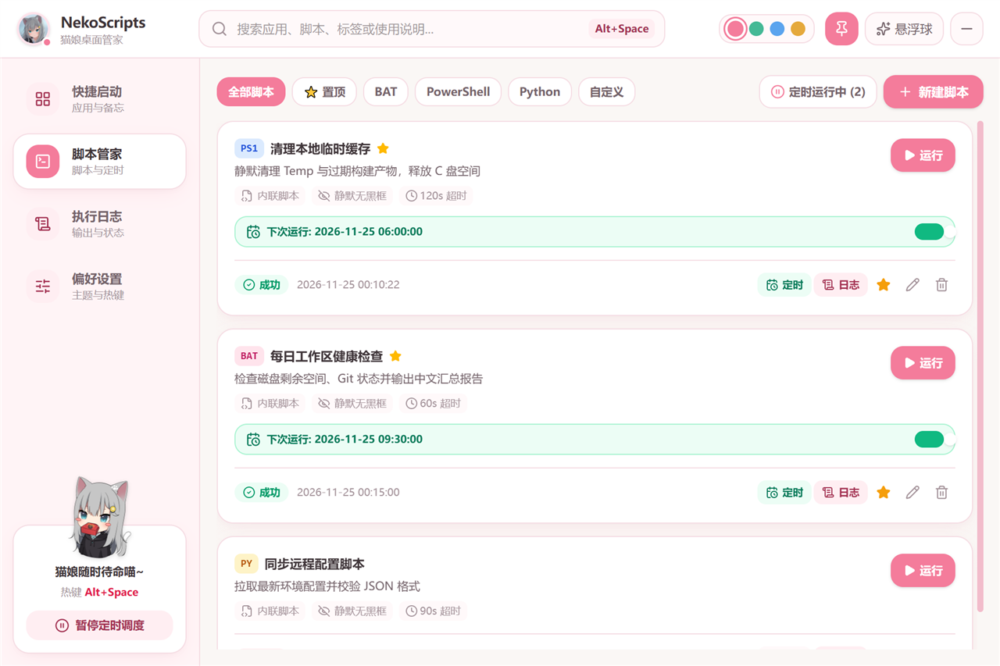
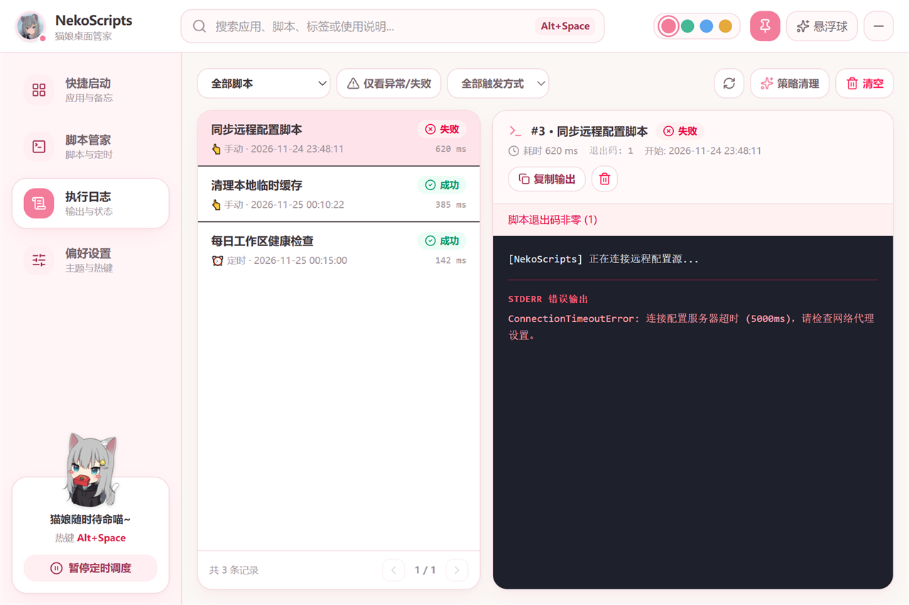
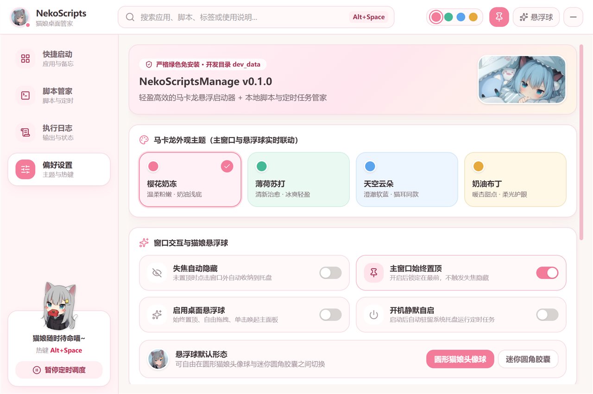

# NekoScriptsManage 🐾

> 一款基于 **Wails v3 + Go + React + TypeScript + SQLite** 打造的 Windows 绿色免安装桌面小工具——结合 **Maye Lite 级别的悬浮快速启动体验** 与 **本地脚本管理 + Cron 定时调度 + 实时日志中心**，采用清爽可爱的日系马卡龙奶油猫娘风设计。


---

## 📸 核心界面预览

### 1. 快捷启动主面板（应用分类 · 拖拽导入 · 极速检索 · Markdown 备忘）
支持直接将桌面 `.exe`、`.lnk` 快捷方式、文件夹拖入窗口自动解析路径并提取高清 PNG 图标；支持方向键选择 + `Enter` 启动、`Ctrl+Enter` 管理员运行，以及右侧滑出式 Markdown 使用说明/快捷键备忘抽屉。



### 2. 本地脚本管家与定时任务调度
支持 `.bat` / `.cmd` / `.ps1` / `.py` 及自定义命令，内置代码编辑器保存内联脚本或关联外部脚本文件；默认后台静默无黑框运行并支持进程树级强制终止与超时控制，内置 `robfig/cron/v3` 可视化简易定时与 Cron 表达式调度。



### 3. 脚本执行日志中心（自动防中文乱码 · 实时流式输出）
每次手动或定时运行均持久化记录耗时、退出码及完整 `stdout` / `stderr`（内置逐行 UTF-8 / GB18030 自动解码防乱码）；支持按脚本/失败状态/触发方式筛选、一键复制完整输出与自动清理历史日志。



### 4. 偏好设置、四套马卡龙主题与绿色便携备份
内置「樱花奶冻 / 薄荷苏打 / 天空云朵 / 奶油布丁」四套浅色马卡龙主题（主窗口与猫娘悬浮球实时联动），支持全局快捷键录制、圆形猫娘头像球/迷你胶囊形态切换、开机静默自启，以及 SQLite 热快照一键打包导出 `.zip` 备份。



---

## ✨ 核心功能特性

- **双窗口悬浮交互（类似 Maye Lite）**
  - 自定义无边框圆角主窗口：顶栏拖拽、实时模糊搜索、置顶图钉开关、失焦自动隐藏（未置顶时）、位置自动记忆。
  - 独立迷你猫娘悬浮窗：默认**圆形猫娘头像球**（支持一键切换迷你圆角胶囊），始终置顶、自由拖拽并自动贴边防出界，脚本运行时呈现翡翠绿呼吸光环与运行数徽章。
  - 全局快捷键与原生托盘：默认 `Alt + Space` 随时呼出/隐藏并聚焦搜索框；关闭窗口自动收纳至 Wails v3 原生 `SystemTray` 保障后台定时任务持续运行。
- **零 CGO Windows 原生能力**
  - 纯 Go COM（`IShellLinkW` + `IPersistFile`）解析 `.lnk` 真实目标路径、参数、工作目录与图标位置。
  - `PrivateExtractIconsW` / `SHGetFileInfoW` + `GetDIBits` 无损提取 32bpp 透明通道图标并缓存为 PNG。
  - 默认 `CREATE_NO_WINDOW` 静默无黑框执行脚本，支持切换弹出终端/管理员提权运行；Windows **Job Object** 原子性终止脚本及其整棵子进程树。
  - 逐行 UTF-8 有效性检测 + `GB18030` 自动转码，彻底告别 Windows 中文命令行乱码。
- **严格绿色免安装（Strict Portable Mode）**
  - 所有数据（SQLite 数据库 `app.db`、图标缓存 `icons/`、内联脚本 `scripts/`、备份 `backups/` 及 WebView2 缓存 `webview2/`）均收敛在可执行文件同级 `./data/` 下，不向 `%APPDATA%` 写入业务数据。
  - 支持通过 SQLite `VACUUM INTO` 在线一致快照一键导出便携 `.zip` 备份。

---

## 🏗️ 技术栈与项目结构

- **后端**：Go 1.26+ · [Wails v3](https://v3.wails.io/) · `modernc.org/sqlite`（纯 Go 零 CGO）· `robfig/cron/v3` · `golang.org/x/sys/windows` · `golang.org/x/text`
- **前端**：React 18 · TypeScript · Vite 8 · Tailwind CSS v4 · Lucide Icons · `react-markdown` + `remark-gfm`

```text
NekoScriptsManage/
├── main.go                     # Wails v3 入口、多窗口、SystemTray 与本地图标中间件
├── assets/                     # 托盘图标与精修透明猫娘贴纸素材
├── build/                      # Wails v3 构建配置、Windows 图标与 DPI 清单
├── docs/screenshots/           # 核心界面预览截图
├── internal/
│   ├── config/                 # 严格便携路径解析（开发 dev_data/ 与发布 ./data/）
│   ├── db/                     # 纯 Go SQLite 初始化（WAL）与版本化 SQL Migration
│   ├── model/                  # 领域实体、DTO 与前后端事件 Payload
│   ├── runner/                 # 异步脚本执行引擎、流式日志与运行中任务追踪
│   ├── scheduler/              # 基于 robfig/cron/v3 的后台定时调度与简易模式转换
│   ├── service/                # 暴露给 Wails v3 的 6 个模块化 Service（自动生成 TS Bindings）
│   └── winapi/                 # 零 CGO Windows API（.lnk/图标/提权/Job Object/热键/贴边/GB18030）
└── frontend/                   # React + TypeScript + Tailwind 前端工程
```

---

## 🚀 开发与编译构建

### 环境要求
- Go `1.24+`（推荐 `1.26+`，无需安装 GCC / MinGW）
- Node.js `20+`
- Wails v3 CLI：`go install github.com/wailsapp/wails/v3/cmd/wails3@latest`

### 常用命令

```powershell
# 1. 运行全部 Go 单元测试
go test -v ./internal/...

# 2. 重新生成 Wails v3 TypeScript Bindings
wails3 generate bindings -ts -i -clean=true

# 3. 构建前端静态资源
cd frontend
npm install
npm run build
cd ..

# 4. 零 CGO 打包单文件绿色便携 Windows 程序（嵌入图标与 DPI 清单）
$env:CGO_ENABLED = "0"
wails3 generate syso -arch amd64 -icon build/windows/icon.ico -manifest build/windows/wails.exe.manifest -info build/windows/info.json -out wails_windows_amd64.syso
go build -tags production -trimpath -ldflags="-w -s -H windowsgui" -o "bin\NekoScriptsManage.exe" .
Remove-Item -Force wails_windows_amd64.syso
```

### 运行参数说明
- `--silent`：静默启动直接驻留系统托盘（开机自启默认附带此参数）。
- `--tab=apps|scripts|logs|settings`：启动时直接定位到指定功能页。
- 环境变量 `NEKO_DATA_DIR`：可选自定义便携数据目录路径。

---

## 🎨 版权与素材声明

- 本项目界面中所使用的猫娘角色立绘、头像、贴纸及图标等美术元素，均取材并二次裁剪自知名画师 **甘城なつき（Amashiro Natsuki / Nachoneko）** 的原创作品，**其完整角色与插画著作权均归原作者 甘城なつき 所有**。
- 本项目为开源非商业性质的个人效率工具，上述猫娘视觉元素仅用于个人学习、界面美化演示与非商业技术交流，**严禁将本项目中的相关美术素材用于任何商业用途或二次售卖**。
- 如原作者或版权方认为本项目对相关素材的使用存在任何不妥之处，请随时通过 GitHub Issue 联系，我们将在收到通知后第一时间下架并替换相关图片素材。
